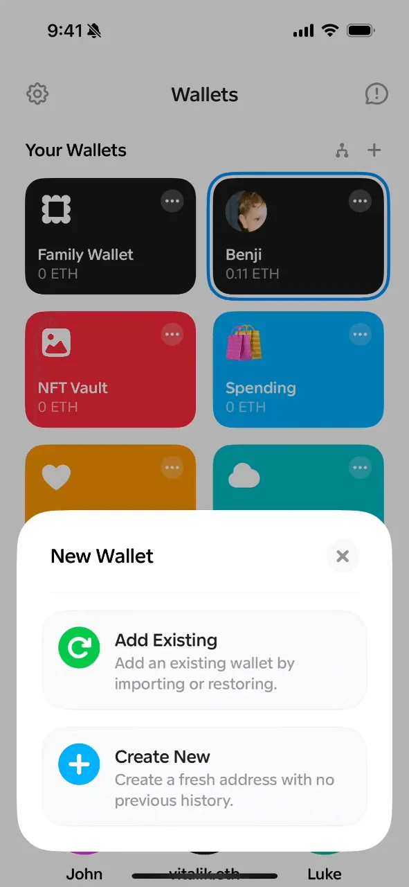
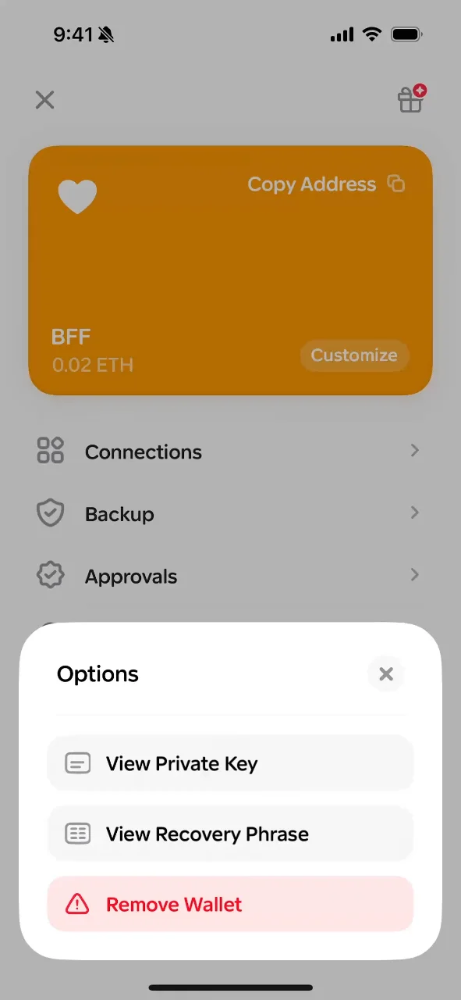
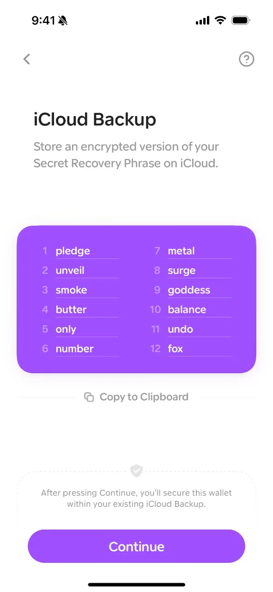
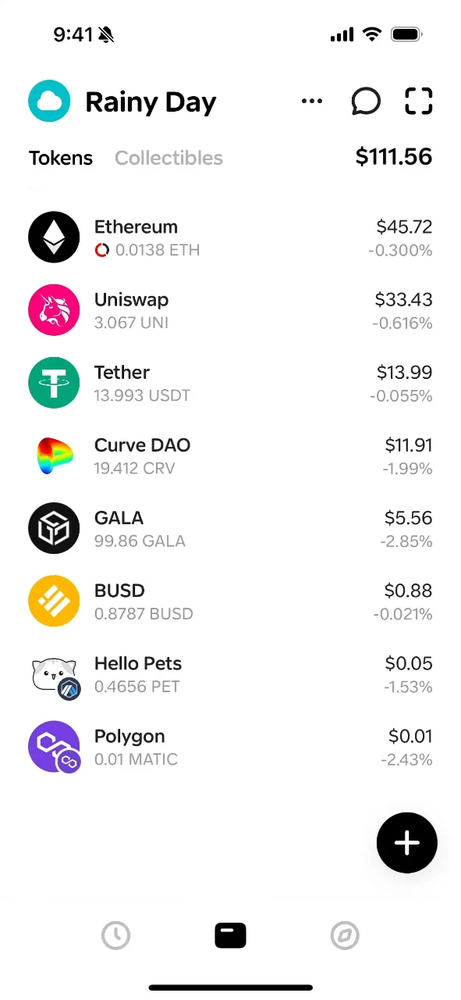
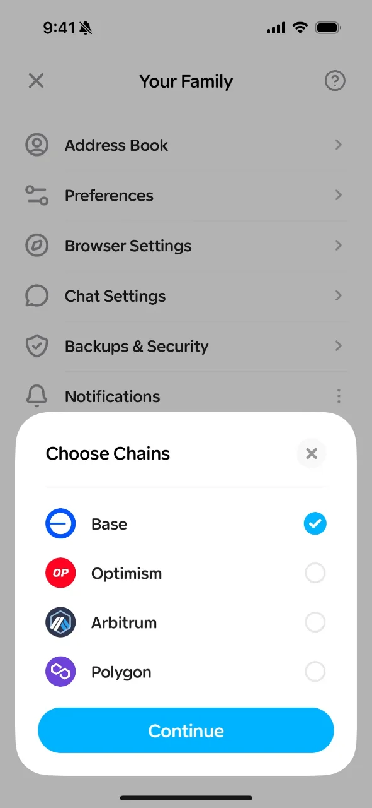
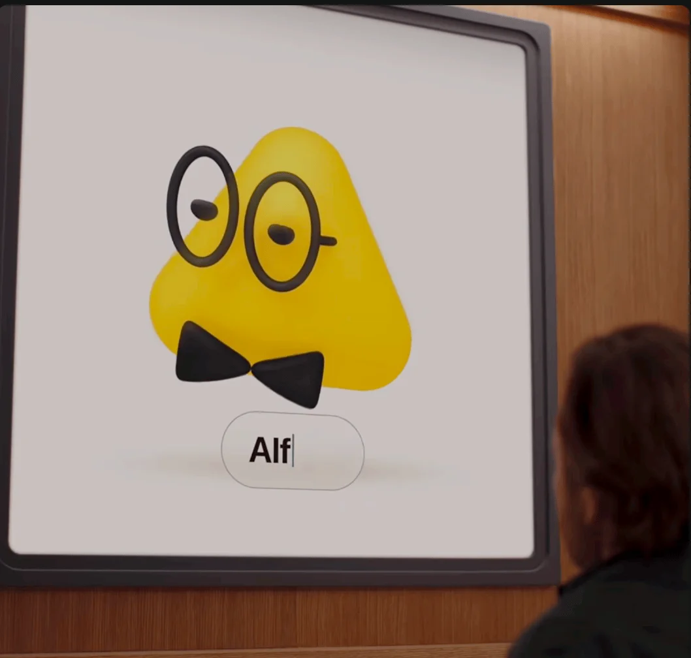
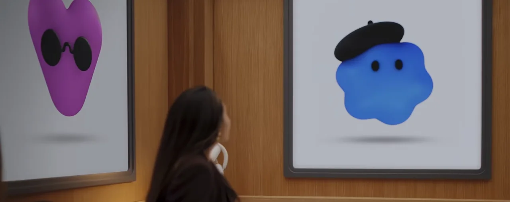
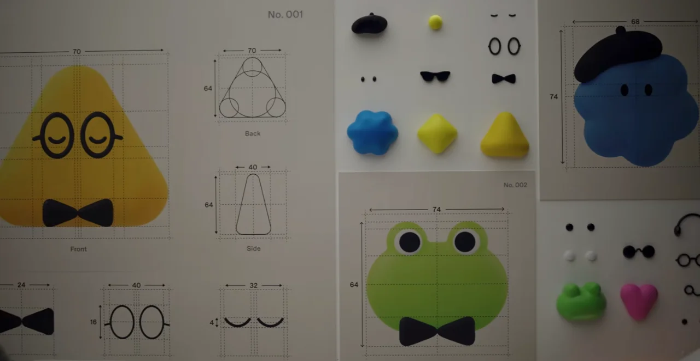

# DOP for iPhone — design PRD

Status: draft for design, 2026-10-10. Companion to [08-phone-approver.md](08-phone-approver.md),
which holds the trust model and the relay protocol. This document is for the
designer: what the app is, every view, every component, how it moves, and what
"done" looks like. Tracked by bd epic dop-cd4.

## Problem Statement

I run agents on several machines. When one of them needs my yes — to bind a
new bearer, to print keys into a transcript, to use a protected grant — the
question is shown as a QR code in the agent's terminal and dies after five
minutes unless the agent relays it. I type a passphrase into a web page served
by the agent's machine, the one page a fake could imitate. Every question looks
the same whether it is routine or dangerous. And when I want to know what an
agent can reach, or trim its access, I have to be at my Mac in the TUI.

## Solution

A native iPhone app where my agents live as characters. It wakes me when one
of them needs a decision, shows me who asks, from where, and what happens if
I say yes, and lets me answer with Face ID (or the passphrase typed on the
phone). From the same place I can look at any agent, see its bearer, its
grants and the services behind them, add or remove a grant, re-issue or revoke,
and reach everything the TUI offers through a menu of the same shape. It is
calm for the routine, loud for the dangerous, and a little alive all the time.

## User Stories

### Waking and deciding
1. As an operator, I want my phone to buzz when an agent needs a decision, so that requests stop dying in a terminal I am not watching.
2. As an operator, I want the notification itself to say who asks and what kind of request it is, so that I can ignore the routine without opening the app.
3. As an operator, I want to open a request from the notification straight into its card, so that a routine claim is one glance and one Face ID.
4. As an operator, I want the card to lead with the effect in plain words ("wants to print keys into an AI transcript"), so that I never approve something dangerous by reflex.
5. As an operator, I want the dangerous kinds (print keys, print bearer) to look and feel different from a claim, so that my hands slow down when they should.
6. As an operator, I want to see who asks (character, name), from where (host, harness), what it touches (service, grant), and the context when it exists (goal, branch, project), so that I understand the request without leaving the card.
7. As an operator, I want to approve with Face ID, so that I never type a passphrase on a page I cannot trust.
8. As an operator, I want to type the approval passphrase on the phone instead, so that I can still answer when Face ID is unavailable (mask, dark, someone else's phone grip).
9. As an operator, I want rejecting to feel decisive and satisfying, so that I am not shy about saying no.
10. As an operator, I want to see several pending requests as a stack and deal with them one by one, so that a burst from a CI run is not overwhelming.
11. As an operator, I want a request that expired or was answered elsewhere (web page, Mac) to leave the stack on its own, so that I never act on a stale question.
12. As an operator, I want a history of decisions with who decided and how (phone, Mac, web), so that I can audit what happened while I was away.
13. As an operator, I want remote claims staged from a server to appear in the same inbox as local ones, so that I have one place for every question.

### Agents as characters
14. As an operator, I want every agent to have a face from the moment it is claimed, derived from its key, so that I recognise agents at a glance and no two share a face by accident.
15. As an operator, I want an agent that offers its own card (name, avatar, traits) to show it to me once for approval, so that a face I come to trust was chosen by me.
16. As an operator, I want an editor to change an agent's face, colour, name and traits, so that my agents feel like mine.
17. As an operator, I want my agents to be visible together on the home screen as a small swarm, so that opening the app feels like checking on a team, not opening a form.
18. As an operator, I want the swarm to reflect real activity when it can (an agent that just used Notion shows a bubble), so that it tells the truth rather than loops a canned animation.
19. As an operator, I want the agent that needs a decision to move from the swarm into its request card without a cut, so that I keep the thread of who is asking.
20. As an operator, I want the swarm to feel alive with one agent and still readable with twenty, so that the app works on day one and at scale.
21. As an operator, I want an agent that is revoked or expired to leave the swarm with a visible farewell, so that the state change is felt, not just logged.

### Looking at an agent
22. As an operator, I want to tap an agent and see its bearer: subject, status, expiry, binding kind and key type, host it was claimed on, portable or not, who issued it, so that I know what this identity is.
23. As an operator, I want to see the grants on its bearer and, behind each grant, the integration and credential it maps to, so that I can see what the agent can reach in one place.
24. As an operator, I want to add a grant to an agent's bearer from a picker of the vault's grants, so that I can widen access without going to the Mac.
25. As an operator, I want to remove a grant from an agent's bearer, so that I can narrow access the moment I notice it is too wide.
26. As an operator, I want to be told when a grant edit needs the agent to re-claim (ed25519 binding) versus applies live (P-256), so that I know what to expect on the agent side.
27. As an operator, I want to re-issue a bearer (rotate in place, new claim, new PIN) from the agent's page, so that a leaked bearer is replaced from wherever I am.
28. As an operator, I want to revoke an agent with a confirmation that names what breaks, so that revocation is deliberate and reversible only by re-issuing.
29. As an operator, I want to see an agent's recent activity (exec per service, approvals, denials), so that I can judge whether its behaviour matches its goal.
30. As an operator, I want the pending request for an agent to be reachable from the agent's page too, so that context and decision are never two taps apart.

### Managing the vault
31. As an operator, I want a menu with the same shape as the TUI (Add, Issue, List, Remove, Vault, More), so that what I learned on the Mac transfers.
32. As an operator, I want to issue a bearer from the phone (subject, grants, expiry, portable, runs on) and get the handoff text to share, so that onboarding a new agent does not need the Mac open.
33. As an operator, I want to list integrations and their credentials, grants, bearers and team, so that the phone is a complete window on the vault.
34. As an operator, I want to add or edit an integration's description, projects and tags and a grant's prefix, projects and tags, so that routine bookkeeping is a phone task.
35. As an operator, I want to remove a grant or an integration with a clear statement of which bearers are affected, so that I do not break an agent by accident.
36. As an operator, I want team: members, devices, pending invites, with approve and delete, so that onboarding a second admin or another phone happens where the notification arrives.
37. As an operator, I want vault status, sync and doctor results, so that I can tell at a glance whether my machines agree.
38. As an operator, I want settings: my paired phone, notification preferences per request kind, passphrase-on-phone on or off, so that the app behaves the way I want.
39. As an operator, I want operations that need the admin key to be executed by my Mac on my signed instruction, with clear feedback when the Mac is offline, so that I understand why something is queued rather than done.

### Pairing and safety
40. As an operator, I want to pair the phone by scanning a QR from the TUI, so that setup is one scan.
41. As an operator, I want pairing to be approved on the Mac like any device invite, so that a stolen QR alone pairs nothing.
42. As an operator, I want to unpair or remote-wipe a lost phone from the Mac, so that its signatures stop counting immediately.
43. As an operator, I want the app to never hold the admin key, a bearer, or a credential value, so that losing the phone is an inconvenience, not a breach.
44. As an operator, I want the app to tell me plainly when the relay is unreachable and that the Mac passphrase path still works, so that an outage never traps a request.

## Views

### V1 — Home: the swarm
The first screen. Agents as characters drifting in a bounded space; density scales with count (one agent sits centre and breathes; twenty cluster and buzz). An agent with a pending request wears a badge. Activity bubbles (stretch) float above an agent briefly when it uses a service. Tap an agent → V3.

Pending requests sit at the bottom of Home as a **folded stack**, like iOS notifications: 3D perspective, the most dangerous one in front, a count on the front card. Tap the stack and it **unfolds into a list that rises to fill the screen** while the swarm shrinks to a strip; rows carry the risk colour; swipe down folds it again. This list is the inbox. There is no separate Inbox tab. History lives under Manage.

Bottom bar, three items as sketched: **Home, Search, Manage**. A general menu, the TUI's shape (Add, Issue, List, Remove, Vault, More), slides up from Manage.

Components: `AgentAvatar` (deterministic face from key, or card image, or edited face), `Swarm` (layout, drift, density rules, reduced-motion fallback), `ActivityBubble`, `RequestStack` (folded / unfolded), `RequestRow`.

### V2 — History
Decisions grouped by day, reached from Manage. Each row: avatar, effect, decision, who decided, how (phone, Mac, web). Tapping a row shows the request as it was.

Components: `DecisionRow`, `KindTag`.

### V3 — Agent page
Header: avatar large, name, host, harness, status. Sections as collapsible cards: Bearer (facts), Grants (each row expands to the integration and credential behind it), Activity, Danger zone (re-issue, revoke). Pending request for this agent, if any, sits at the top as a card and opens V4 with the avatar staying in place.

Components: `AgentHeader`, `BearerFacts`, `GrantRow`, `IntegrationPeek`, `ActivityList`, `DangerZone`.

### V4 — Request card (full)
The decision view, reached by tapping a pill in the stack or a row in the unfolded list; the character flies from there into the card. Top third: **the character, large**, name under it, then the effect sentence as a verb ("wants to bind a new bearer"). Middle: **the facts as swipeable pages** in one known component, with a page indicator. Page 1 is always the risk: "Routine · a new agent key on hermes-vps" (green), "HIGH RISK · keys will be shown in an AI transcript" (red), "Protected grant · …" (amber). Pages advance by swipe; when the request is close to expiry (last minute, or a grant about to lapse) they auto-advance slowly so the countdown page is reached without a gesture, and any touch stops the auto-advance. Then from (host, harness), touches (service, grant, env name), expires (countdown), context (goal, branch, project when declared), and for dangerous kinds, the safe alternative (dop exec). Bottom: Approve with Face ID and Reject; a small "type the passphrase instead".

Risk is never a separate badge. It is the first page, the colour of that component, and for red kinds a tint of the header area, heavier haptics, and a one-second hold before Approve is live. On red kinds Reject is the primary button and Approve the outline one.

Components: `CharacterStage`, `EffectHeadline`, `FactPager` (pages, colour by meaning), `ApproveButton` (label morphs Approve → Approving → Approved), `RejectButton`, `PassphraseSheet`, `ExpiryRing`.

### V5 — Character editor
Opened from V3 header. Shape, eyes, brows, colour, accessory; name and traits. Live preview on the same avatar instance that will travel back to the swarm. "Offered by the agent" card shown here for accept / replace when one exists.

Components: `FaceCanvas`, `TraitChips`, `OfferedCard`.

### V6 — Grant picker
From V3 Grants › Add. The vault's grants grouped by integration, with the ones already on the bearer marked. Protected grants ask the approval passphrase (sheet). Confirm shows the new grant set and whether it applies live or needs a re-claim.

Components: `GrantPicker`, `PassphraseSheet`, `ChangeSummary`.

### V7 — Issue bearer
Mirrors the TUI wizard as trays: subject → grants → expiry → portable → runs on → review → shown-once handoff with a share button. The handoff is shown once; leaving needs a second confirmation.

Components: `Tray` stack, `OnceScreen`, `ShareHandoff`.

### V8 — Services
Integrations list → integration page (kind, credentials, projects, tags, description, the grants that use it, the bearers behind those grants). Edit metadata in trays. Remove with affected-bearers statement.

### V9 — Team
Members, devices (phones included), pending invites with approve / delete. Pair another phone from here.

### V10 — Vault and More
Status, sync, doctor as a read view with one action each. Settings: notifications per kind, passphrase-on-phone, this device, unpair.

## Visual direction

Taken from the inspiration boards on the Squig canvas (2026-10-12). The images are in [media/ios-inspiration](media/ios-inspiration/); point the designer agent at them.

### Inspiration board

**App surface — Family wallet (Benji Taylor)**

| | | |
|---|---|---|
|  |  |  |
| Big rounded cards, one flat colour each; a white tray rising over the dimmed grid; two-line option rows with a coloured leading icon. | A hero card, then a plain list with icons and chevrons; the tray holds the risky actions and colours the dangerous one red. | A coloured content block, a full-width pill button, calm paper around it. |
|  |  |  |
| Dense list that still breathes: round icons, bold name, muted second line, right-aligned numbers. | A large number as the hero, status pill, key/value rows under it — the shape of our request card facts. | Settings rows with a leading icon; a tray with a radio list and one blue Continue. |

**Characters — soft 3D clay, one colour, a parts kit**

| | |
|---|---|
|  |  |
| One body shape, one saturated colour, two accessories, a name field under it. This is the agent page header and the editor's preview. | Different shapes, same family: heart with sunglasses, cloud with a beret. Eyes are two dots; the shape and the accessory carry the personality. |
|  |  |
| The system itself: measured front / side / back sheets ("No. 001"), and the kit on the wall: shapes, eyes, brows, glasses, bow tie, beret, heart. Our editor is this wall. | Blobs stacking and leaning on each other, each a different colour, same eye language. The swarm when agents cluster. |

**World — the ceiling**

Bold geometry, saturated cyan / red / yellow, playful depth. Reserved for the pairing screen, an empty swarm and the big moments. Never on a decision screen.

**App surface: "Family" lineage.** Off-white paper, near-black type, big rounded cards in flat saturated colours, generous radii (24–28 pt), full-width pill buttons, one blue for primary actions, white trays rising over dimmed content, list rows with a leading icon and a chevron. Bold rounded grotesk at large sizes; numbers and names set big. Nothing outlined where a fill will do. Dark mode flips paper and ink and keeps the saturated colours.

**Characters: soft 3D clay, one colour, simple face.** The agents are physical-feeling blobs in a small family of body shapes — rounded triangle, cloud, heart, disc, pebble — each in one saturated colour (yellow, blue, purple, green, orange, black), with modular parts from a fixed kit: eyes (dot, oval, closed), brows, glasses (round, frame), bow tie, beret, cap. Each character has a spec sheet feel: front, side, measured, the way the inspiration frames them as "No. 001". The default face is derived from the agent's key (shape, colour, eyes, one accessory); the editor swaps parts from the same kit, so every agent stays in the family. Characters can stack and lean on each other in the swarm, like the stacked-blob reference.

**Risk colours, fixed.** Green = routine, amber = protected or expiring, red = high risk. Nothing else in the app uses red. Agent body colours never carry meaning.

**Open: the app's own colour versus the agents' colours.** Undecided (2026-10-12). Options for the designer to show: (a) the app is neutral, paper and ink only, and agents own every saturated colour; (b) the app has one brand colour that no agent may wear; (c) the operator's own devices get a reserved colour so a phone never reads as an agent. Show all three on the Home screen.

**Energy budget.** The maximalist isometric illustration on the board is the ceiling, not the floor: that much colour and depth is for the pairing screen, an empty swarm, and the big moments (first agent, farewell). Day-to-day screens stay calm so the characters and the risk colour do the talking.

**Tokens for the designer agent.** Paper #F7F6F2, ink #111, blue primary, risk green/amber/red, six character colours; radius 28 (cards, trays), 16 (rows), pill buttons 52 pt tall; type scale 34 / 22 / 17 / 13; spacing 8-grid; haptics: light on approve routine, heavy on reject and on red approve.

See also [10-character-system-prompt.md](10-character-system-prompt.md): the prompt to generate and iterate the character system with an image model.

## Motion and continuity principles

Adopted from Benji Taylor's "Family values" and adapted:

- **Persistence.** A component that will exist in the next screen stays the same component. The agent avatar is the primary persistent element: swarm → stack row → request card → agent page → editor, always the same instance moving, never a cut. The request stack unfolds into the list and the list row grows into the card; nothing is replaced. Grant rows persist from the agent page into the picker.
- **Fly, don't teleport.** Every transition explains the route from A to B. Tab changes move in the direction of the tab. Trays rise over the current screen so context stays visible; full-screen pushes are reserved for the request card, which deserves the whole stage.
- **Trays for depth.** Multi-step flows (issue bearer, grant picker, passphrase) are successive trays of different heights so progress is read from the silhouette.
- **Text morphs for action.** Approve → Approving → Approved shares letters; Reject does the same. The headline of a request never changes wholesale under the finger.
- **Delight-impact curve.** Frequent actions (approve a claim) get small, quick, consistent feedback. Rare actions (revoke, unpair, first pairing, an agent's farewell) earn the big moments. Never repeat a big moment on a frequent action.
- **Uniform polish.** The settings screen and the doctor view get the same care as the swarm, or the whole app reads as unfinished.
- **Truthful motion.** The swarm shows real state. No fake busyness. Reduced Motion is honoured: drift becomes still, transitions become fades, nothing is lost.
- **Speed budget.** A routine claim from notification to approved is under three seconds of the user's attention: no intro animation stands between the tap and the card.

## Implementation Decisions

- **Two planes.** Decisions (approve, reject) are signed on the phone and verified by the requester; they need no Mac. Management (grants, issue, revoke, integrations, team) are signed commands the admin Mac executes through its daemon; the phone shows "queued for your Mac" when it is offline. The design must make the plane visible without making it a lesson.
- **Revive from the phone.** When the Mac's admin session has timed out, a management command prompts the phone: "Your Mac's admin session is locked — revive it?" Face ID revives it for one command or for the configured window. Design this as a tray on top of the pending command, never as a dead end. It is the paid-only admin convenience; the TUI stays complete without it.
- **Identity.** The phone is a paired device with a Secure Enclave key, recorded in the vault and approved like any device. Avatars are labels on identities, never identities.
- **Agent card.** A small, agent-declared card (name, image or shape spec, traits) stored on the binding at claim or later via exec; shown once to the operator before it is used; operator edits override and are signed by the operator.
- **Default face.** A deterministic face derived from the agent public key, rendered by the app; the same key gives the same face on every device.
- **Request content** reaches the phone sealed to its key through the relay on Cloudron; the phone never runs git. Activity ticks, when present, carry subject and service name only.
- **Approval kinds** are a closed set: claim, remote-claim, protected-grant, print-bearer, print-keys. Mood, colour and copy are defined per kind once and shared with the web page.
- **Context fields** on a request: subject, agent name, host, harness, kind, effect, service, grant, expiry, and optional goal, branch, project, generation. Goal and project are declared by the agent (future exec flag, separate conversation); branch and working directory are read by dop when present.
- **Native SwiftUI**, shared-element transitions for the avatar, trays as a reusable container, haptics paired with each decision state.

## Testing Decisions

- Protocol and relay are tested on the dop side (e2e scripts in the existing style, a second Mac as the first "device") before any app code; the app is never the only test of the signing path.
- App: snapshot tests of each view in light/dark and Reduced Motion; a scripted walk of the five request kinds; a deterministic-face test (same key → same face, different keys → different faces, across app versions).
- Good test: external behaviour only. The swarm is tested for layout rules (density bands, readable at one and at twenty), not for pixel positions.

## Out of Scope

- 3D avatars, avatar generation from a photo.
- Any handling of the admin passphrase on the phone. (Reviving the Mac session with Face ID is in scope; typing the admin passphrase on the phone is not.)
- Credential values ever displayed on the phone.
- Traffic monitoring, threat scoring, goal declaration on exec (future work, separate conversation; this design leaves room for a per-agent activity view and a context block).
- Android.

## Further Notes

- Camille's wireframes and inspiration boards live on the Squig canvas "Dop" (Orca browser tab); the reworked screens there (request cards v2, folded / unfolded stack, fact pages, agent detail, issue tray, shown-once, revive, character editor) are the starting point for the designer agent.
- The same per-kind presentation rules should be ported back to the web approval page so both surfaces agree (dop-dkj).
- Phasing: the swarm, inbox, request card and agent page (read-only) are the prototype; grant add/remove and revoke are the first management commands; issue and the full menu follow.
